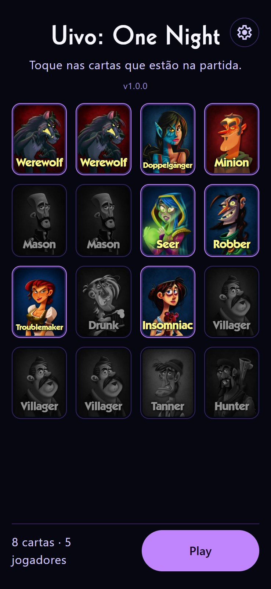
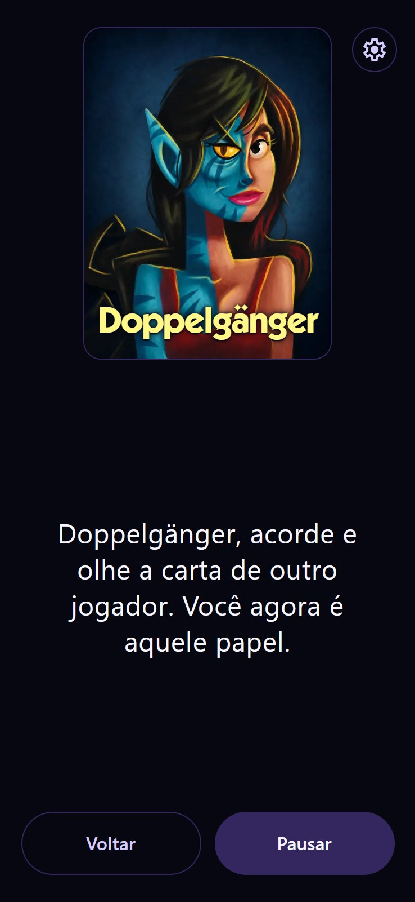
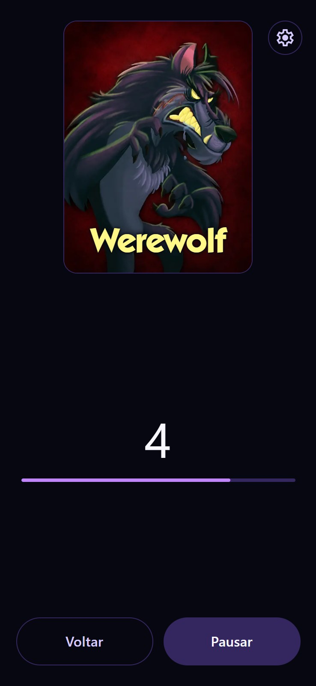

  

<h1 align="center">Uivo: One Night</h1>

  Narrador automático de <em>One Night Ultimate Werewolf</em>, em PT-BR. 
  Aperta Play e todo mundo joga: ninguém fica de fora narrando.

  
  

  <a href="https://github.com/FrassonRa/uivo-one-night/releases/latest"><strong>⬇ Baixar o app (.apk)</strong></a>

---

## O que é

*One Night Ultimate Werewolf* é um jogo de dedução social rápido, onde cada
rodada dura só uma noite. O problema: alguém sempre precisa ficar de fora
narrando, lendo as instruções de cada papel na ordem certa, cronometrando as
pausas, mandando todo mundo fechar os olhos de novo. Essa pessoa não joga.

O **Uivo** resolve isso narrando a noite inteira sozinho, direto do celular.
Todo mundo senta à mesa e joga, inclusive quem seguraria o app.

## Como jogar

  
  
  

1. **Escolha os papéis** da partida na grade de personagens. O app avisa se
   faltar carta ou se algum par obrigatório (como os Masons) ficar incompleto.
2. **Aperte Play.**
3. Coloque o celular no meio da mesa e **feche os olhos**: o app chama cada
   papel na ordem certa, com uma pausa para a ação acontecer antes de mandar
   todo mundo fechar os olhos de novo.
4. A narração termina em **"Todos, acordem!"** e a discussão do dia começa
   (isso já é conversa de mesa, sem o app).
5. Ao voltar pra tela inicial, os papéis da rodada anterior continuam
   marcados. Pra jogar de novo é só apertar Play.

A narração é em **português**, mas os **nomes dos papéis são ditos em inglês**
("Werewolves, acordem…", "Seer, acorde…"), do jeito que vem escrito nas cartas
físicas e como a mesa costuma falar.

## O que o app faz

- 🐺 **Seleção com validação embutida**: o app confere se o número de cartas
  está certo e se os pares obrigatórios foram respeitados antes de deixar
  começar.
- 🌙 **Narra a noite inteira sozinho**, na ordem oficial do jogo, pulando
  automaticamente os papéis que não estão na partida.
- 🎙️ **Espera cada fala terminar antes de seguir para a próxima**, sem
  atropelar uma instrução por cima da outra.
- ⏸️ **Pausar, continuar ou voltar a qualquer momento**: o telefone toca, ou
  alguém abre o olho na hora errada, dá pra parar sem perder a partida.
- 🔒 **A tela não apaga sozinha** durante a narração.
- 🌗 **Tema escuro de propósito**: a partida acontece no escuro, sem
  estourar brilho na mesa.

## Como instalar

O app ainda não está na Play Store, então a instalação é manual:

1. Toque em **[Baixar o app](https://github.com/FrassonRa/uivo-one-night/releases/latest)**
   e baixe o arquivo `.apk` da versão mais recente.
2. Abra o arquivo baixado. O Android vai avisar que é um app de fora da loja,
   toque em **"Instalar mesmo assim"** (ou libere a instalação de fontes
   desconhecidas, se pedido).
3. Abra o app depois de instalado. Pronto.

## Perguntas frequentes

**Precisa de internet?**
Não. Depois de instalado, o app funciona 100% offline.

**O app guarda algum dado meu?**
Não. Não tem conta, não tem coleta, não tem rede. Tudo fica só no aparelho.

**Para quantos jogadores funciona?**
De 3 a 10 jogadores, seguindo a caixa base do jogo.

**Por que não está na Play Store?**
É um projeto pequeno e gratuito, feito para resolver um problema específico
de mesa. Publicar na loja não é uma prioridade no momento.

**É de graça?**
Sim, sempre.

## Sobre o jogo

*One Night Ultimate Werewolf* é um jogo de Ted Alspach, publicado pela
Bezier Games em 2014. O Uivo é um projeto independente de fã, sem ligação
com a Bezier Games.

## Encontrou um problema ou tem uma ideia?

[Abra uma issue](https://github.com/FrassonRa/uivo-one-night/issues/new/choose)
contando o que aconteceu ou o que você gostaria de ver no app.
